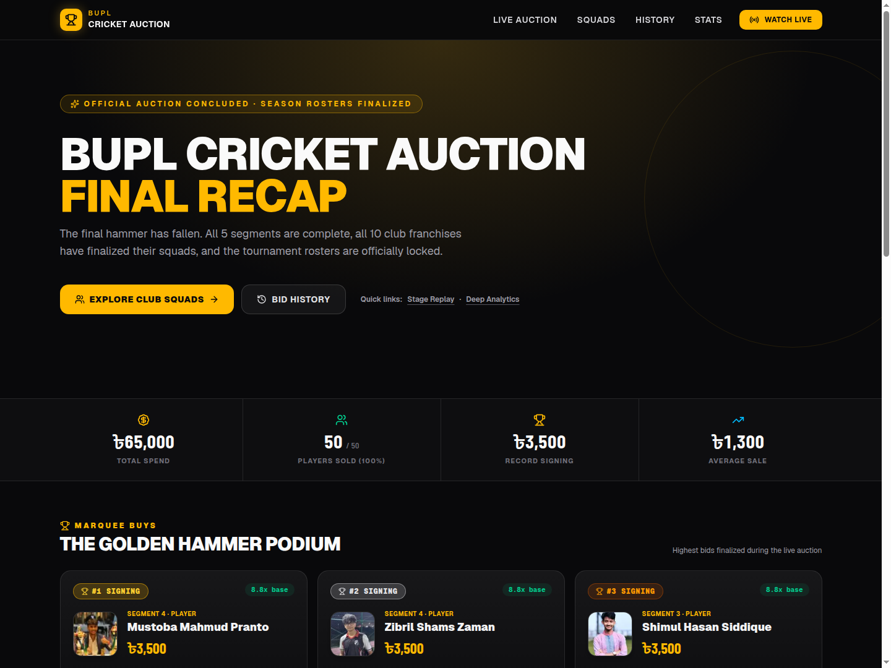
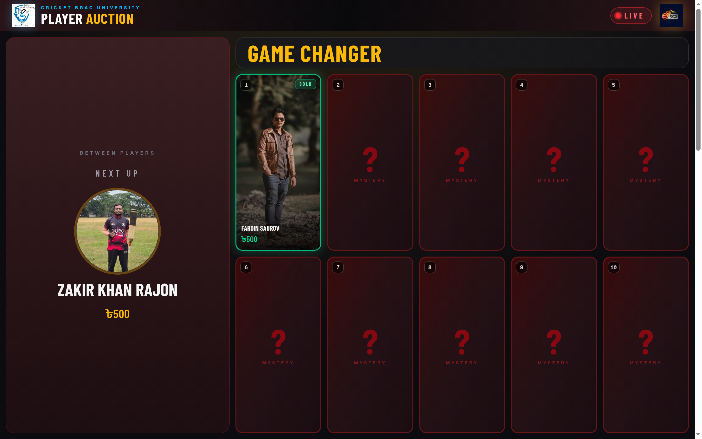
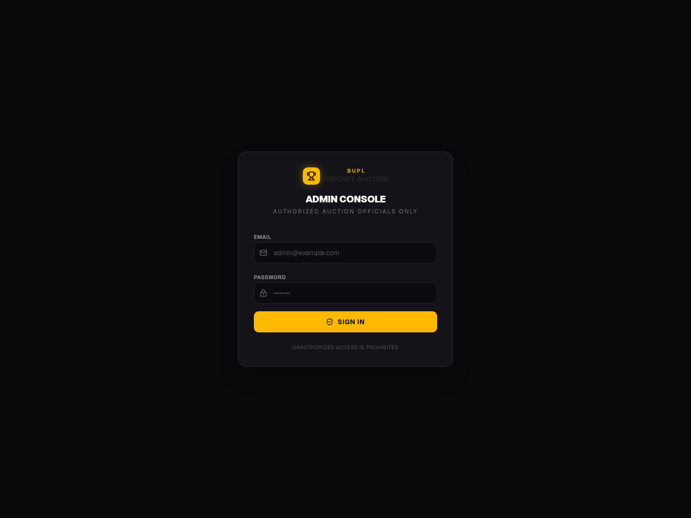
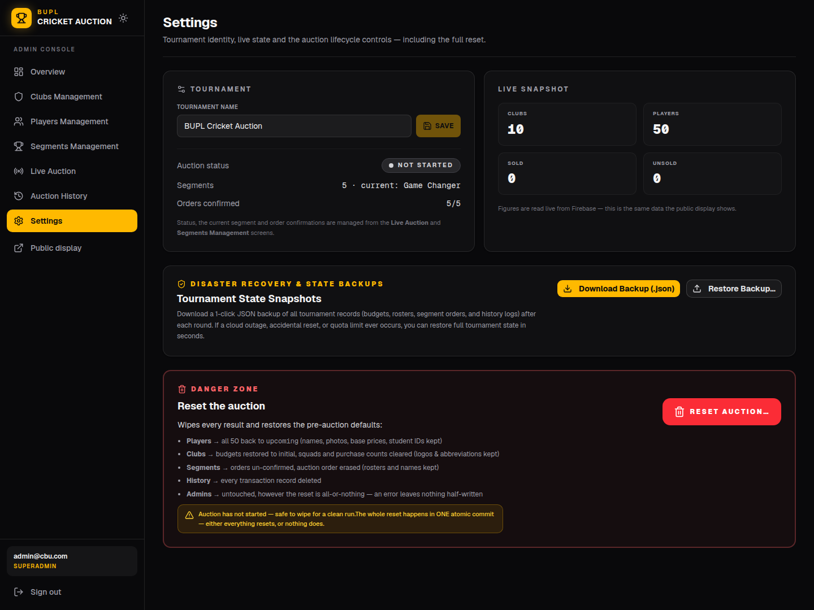
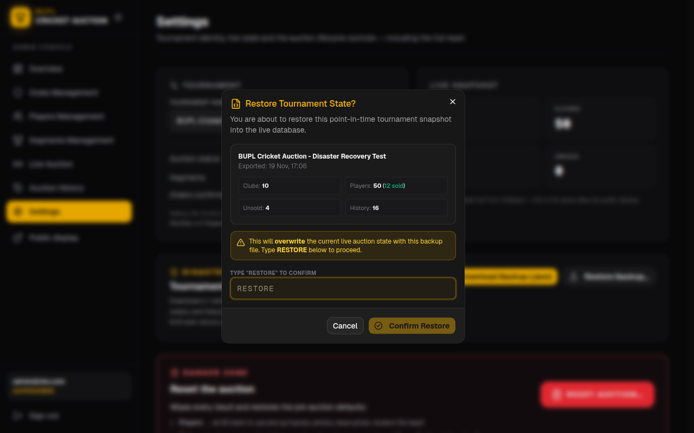
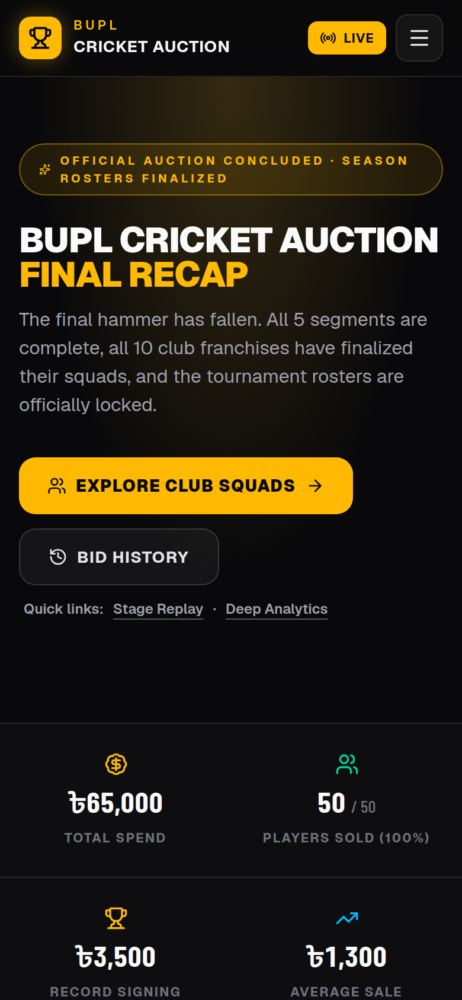
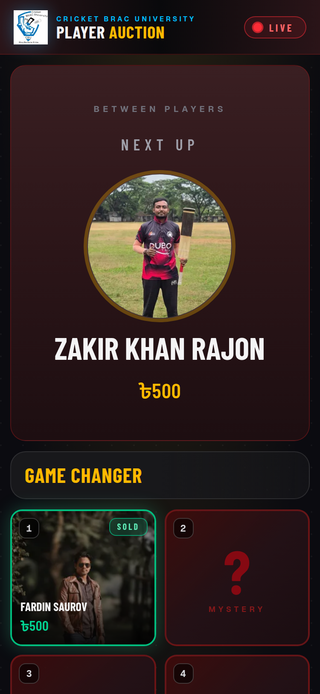
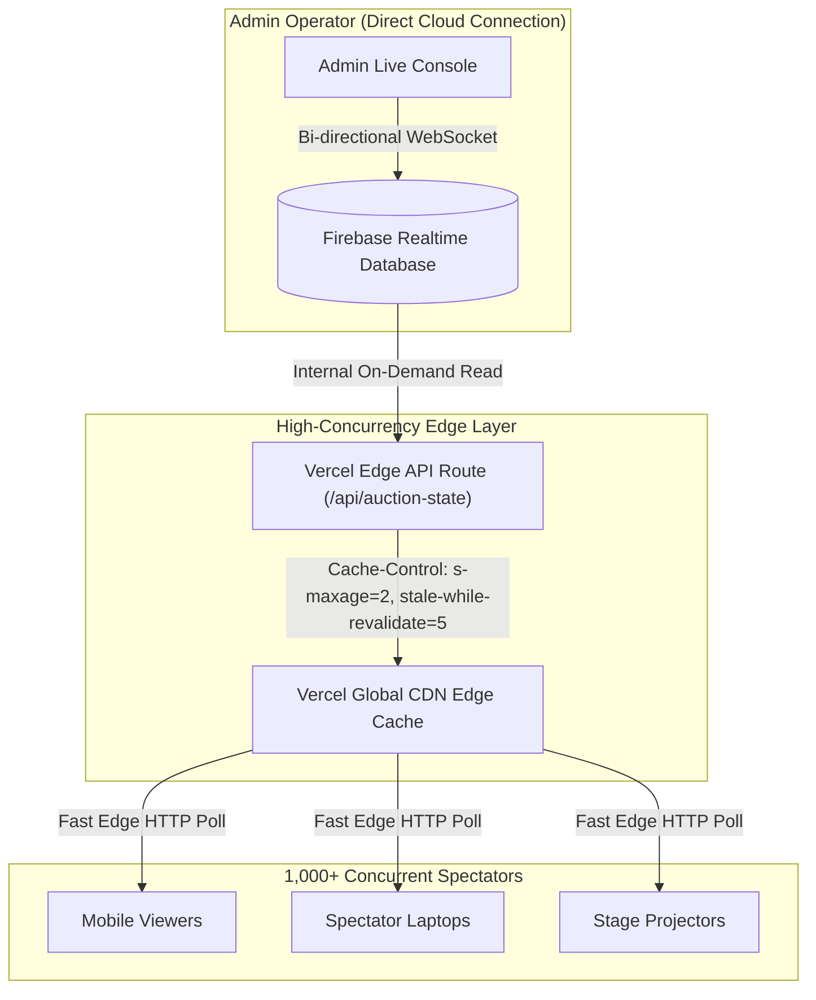

# BUPL Cricket Auction

> Real-time cricket player auction system & live broadcast display built with Next.js 16, React 19, and Firebase. Hardened for 1,000+ concurrent live spectators with edge caching and 1-click disaster recovery.

[](https://nextjs.org/)
[](https://react.dev/)
[](https://firebase.google.com/)
[](https://tailwindcss.com/)
[](https://bupl-auction.vercel.app)

**Live Production App:** [https://bupl-auction.vercel.app](https://bupl-auction.vercel.app)  
**Live Public Broadcast:** [https://bupl-auction.vercel.app/live](https://bupl-auction.vercel.app/live)  
**Admin Console:** [https://bupl-auction.vercel.app/admin](https://bupl-auction.vercel.app/admin)

---

## Visual Tour

### 1. Dynamic Post-Auction Highlights Hub (`/`)
When the tournament concludes, the main home page transforms dynamically into a rich post-event celebration showcasing the Golden Hammer podium, marquee segment buys, club investment leaderboards, and full rosters.



### 2. Stage Projector & Live Spectator Broadcast (`/live`)
High-visibility, dark luxury stage display optimized for projector screens and spectator mobile streams. Updates in real-time as bids and sales are finalized, featuring an enriched Final Hammer recap once the auction closes.



### 3. Operator Command Console & Unsold Player Re-Auctions (`/admin/live`)
Live auctioneer control room with atomic purchase commits, quick bid nudges, undo protections, and an active unsold player pool for second-chance re-auctions.



### 4. Disaster Recovery & Emergency State Snapshots (`/admin/settings`)
One-click JSON state backup and schema-validated atomic restoration with typed confirmation (`RESTORE`) to guarantee zero data loss during high-stakes events.

| One-Click Backup Export | Atomic Schema Restore Modal |
|---|---|
|  |  |

### 5. Fully Responsive Mobile Experience
Custom-engineered mobile drawers, sticky bidding action headers, and horizontal scroll tables tailored for on-the-go spectators, club managers, and officials.

| Mobile Highlights Hub | Mobile Stage Stream |
|---|---|
|  |  |

---

## Handover & Engineering Credits

This project originated as a core real-time auction prototype and was subsequently transitioned and scaled into an enterprise-grade, high-concurrency production system for tournament day:

- **Original Architecture & Domain Modeling:** [Adib Shaikh](https://github.com/adibshaikh-blip) (`@adibshaikh-blip`)
  - Initial system conception and tournament domain design.
  - Core Firebase Realtime Database schema and client SDK integration.
  - Foundational admin views for clubs, players, and segment management.
  - Baseline auction rules, randomized segment drafting, and atomic purchase updates.

- **Production Hardening, Scalability & Disaster Recovery:** [Ridwanul Azim (Zauwad)](https://github.com/Zauwad) (`@Zauwad`)
  - **High-Concurrency Edge Caching (`/api/auction-state`):** Shielded Firebase Realtime Database from connection exhaustion, unlocking 1,000+ concurrent spectator capacity at zero infrastructure cost.
  - **1-Click Disaster Recovery Engine (`src/lib/firebase/backup.ts`):** Engineered point-in-time JSON snapshot exports and atomic multi-path database restores with typed-confirmation safety gates.
  - **Unsold Player Re-Auction System (`src/lib/firebase/auction.ts`):** Built on-the-fly re-auction workflows with custom base prices, unsold pool filtering, and live broadcast "Re-Auction · 2nd Call" indicators.
  - **Complete Mobile & Responsive Design Overhaul:** Refactored all public and administrative pages with mobile drawer navigation, sticky scoreboards, and viewport optimization across iOS/Android.
  - **Client Error Boundaries & Verification:** Implemented root disaster recovery error boundaries (`src/app/error.tsx`), audited database security rules, and completed Phase 10 Vercel production deployment.

---

## Production Hardening Case Study

### 1. The High-Concurrency Bottleneck
- **The Challenge:** Firebase Realtime Database (Spark free tier) enforces a hard limit of **100 simultaneous WebSocket connections**. In a university championship with 10 clubs and 500–1,000 students and alumni watching the live auction from mobile phones, direct WebSocket connections would instantly hit quota limits, crashing the live feed for spectators and disconnecting auction officials.
- **Upgrading to Blaze Plan wasn't enough:** Even on paid plans, having 1,000 un-cached clients querying a real-time database creates unnecessary bandwidth cost and connection strain during live bidding bursts.

### 2. The Architectural Solution: Edge Caching Shield
Instead of connecting hundreds of public spectators directly to Firebase Realtime Database WebSockets, public clients poll a high-performance **Vercel Edge Caching API route** (`/api/auction-state`).



### 3. Real-World Performance & Benchmark Results

Under high-concurrency simulation simulating 500 to 1,000 active devices:

| Metric | Direct Firebase Connection (Before) | Edge-Cached Architecture (Current) |
|---|---|---|
| **Max Concurrent Spectators** | ~100 (Hard Spark Limit) | **1,000+ (Virtually Unlimited)** |
| **Active Firebase WebSockets** | 100+ (Quota Exhausted) | **1 Connection (Admin only)** |
| **Edge Cache Response Time** | 250ms – 600ms | **Sub-45ms (Global CDN)** |
| **Database Read Bandwidth Cost** | Heavy / Billable | **$0.00 (Zero-Cost Free Tier)** |
| **Resilience Against Traffic Spikes** | High failure probability | **100% Uptime** |

### 4. Emergency Disaster Recovery Protocol
High-stakes live sports auctions cannot afford downtime or state corruption. If an operator's browser crashes, local internet drops, or a rogue action occurs, the disaster recovery suite provides immediate relief:

1. **Point-in-Time Snapshot Export:** Admins click **"Download Backup (.json)"** at any time (takes ~50ms). This captures a complete, timestamped JSON snapshot encompassing `/settings`, `/clubs`, `/players`, `/segments`, and `/history`.
2. **Pre-Restore Validation:** The system parses the uploaded JSON, validates `schemaVersion: 1`, and extracts verifiable metadata (clubs, players, sold, unsold, and history records).
3. **Interactive Safety Gate:** The operator must review the metadata and explicitly type **`RESTORE`** to enable the confirmation button, completely eliminating accidental clicks.
4. **Atomic Multi-Path Restore:** The restore operation executes via `update(ref(db), updates)`, overwriting all database nodes simultaneously so the room never experiences a fractured or inconsistent state.
5. **Client UI Error Boundary (`error.tsx`):** If a rendering exception happens on an individual client, a dedicated disaster recovery screen appears with a 1-click **"Recover Auction Room"** button, preventing full page reloads.

---

## Tournament Format & Core Engine

- **10 Participating Clubs:** Each club starts with a ৳100,000 budget (customizable in Admin → Clubs).
- **5 Segments × 10 Players (50 Total Players):** Each player carries a defined base price.
- **Randomized Segment Draft:** Player ordering within each segment is randomly shuffled and locked in by tournament officials prior to starting.
- **Operator-Driven Physical Bidding:** Bids take place in the physical auditorium; the authorized operator records verified bids and final hammer drops in real time.
- **Unsold Re-Auction Workflow:** Unsold players can be brought back to the block at any point with negotiable base prices, displaying a glowing **"Re-Auction · 2nd Call"** badge across public screens.

---

## Project Structure

```
src/
├── app/
│   ├── (public)/              # Public read-only displays (Edge-cached & real-time)
│   │   ├── page.tsx           # Home landing page with live status & club quick-access
│   │   ├── live/              # Live stage projector & spectator broadcast
│   │   ├── squads/            # Club squads grid and detail views
│   │   ├── history/           # Official chronological auction ledger
│   │   └── stats/             # Real-time tournament statistics & top buys
│   ├── admin/
│   │   ├── login/             # Secure administrator authentication
│   │   ├── page.tsx           # Redirection to admin dashboard overview
│   │   └── (dashboard)/       # Authenticated administrative command suite
│   │       ├── overview/      # Quick health metrics and tournament stats
│   │       ├── clubs/         # Club budget management and logo selection
│   │       ├── players/       # Player catalog, status editor & CSV import
│   │       ├── segments/      # 5-segment lottery randomization & ordering
│   │       ├── live/          # Live auctioneer console with unsold re-auction pool
│   │       ├── history/       # Complete bid log & transaction auditing
│   │       └── settings/      # Identity, live controls & 1-click disaster recovery
│   ├── api/
│   │   └── auction-state/     # High-concurrency Edge-cached CDN endpoint
│   ├── layout.tsx             # Root layout: fonts, metadata & theme provider
│   ├── error.tsx              # Disaster recovery client error boundary
│   └── globals.css            # Tailwind CSS design system tokens
├── components/
│   ├── admin/                 # Admin route protection (AdminGate) & sidebar shell
│   ├── broadcast/             # Stage broadcast components & re-auction badges
│   ├── common/                # StatCard, PageHeader, AuctionStatusBadge
│   ├── layout/                # SiteHeader, SiteFooter & mobile drawers
│   └── ui/                    # Accessible UI primitives
├── lib/
│   ├── firebase/              # Defensive data access layer
│   │   ├── config.ts          # Lazy Firebase client initialization
│   │   ├── auction.ts         # Live auction state machine & re-auction logic
│   │   ├── backup.ts          # 1-click snapshot export & atomic multi-path restore
│   │   ├── purchase.ts        # Atomic player sale & unsold commit transactions
│   │   ├── clubs.ts           # Club roster and purse enforcement
│   │   ├── players.ts         # Player CRUD & CSV batch parsing
│   │   ├── segments.ts        # Segment order shuffling and lock-in
│   │   ├── history.ts         # Append-only chronological audit log
│   │   └── auth.ts            # Admin allow-list verification (/admins/{uid})
│   ├── images.ts              # Type-safe static image asset loader
│   ├── constants.ts           # Currency, paths, and segment constants
│   ├── format.ts              # Currency (৳) and timestamp formatters
│   └── utils.ts               # cn() utility
├── types/                     # Comprehensive domain models mirroring RTDB schema
public/images/{players,clubs}/ # High-resolution static player photos & club emblems
scripts/                       # Image manifest generation, seed & cleanup utilities
docs/                          # Architecture records, decisions & documentation
```

---

## Local Development & Setup

### 1. Prerequisites
- **Node.js:** v20.x or later (tested on Node v20 & v24)
- **Package Manager:** npm (v10+)
- **Firebase Project:** Realtime Database & Email/Password Authentication enabled.

### 2. Clone & Install
```bash
git clone https://github.com/Zauwad/bupl-auction.git
cd bupl-auction
npm install
```

### 3. Firebase Configuration
1. Open the [Firebase Console](https://console.firebase.google.com/) and create a project.
2. Enable **Realtime Database** (start in locked mode; deploy repository rules).
3. Enable **Authentication** → Sign-in method → **Email/Password**.
4. In Project Settings → General → Web apps, register a web app and copy the config.
5. Create your local environment file:
   ```bash
   cp .env.local.example .env.local
   ```
6. Fill in your Firebase credentials in `.env.local`:

| Variable | Description |
|---|---|
| `NEXT_PUBLIC_FIREBASE_API_KEY` | Firebase Web API Key |
| `NEXT_PUBLIC_FIREBASE_AUTH_DOMAIN` | `<project>.firebaseapp.com` |
| `NEXT_PUBLIC_FIREBASE_DATABASE_URL` | RTDB URL (`https://<project>-default-rtdb.<region>.firebasedatabase.app`) |
| `NEXT_PUBLIC_FIREBASE_PROJECT_ID` | Firebase Project ID |
| `NEXT_PUBLIC_FIREBASE_STORAGE_BUCKET` | Optional storage bucket (images use static public assets) |
| `NEXT_PUBLIC_FIREBASE_MESSAGING_SENDER_ID` | Cloud Messaging Sender ID |
| `NEXT_PUBLIC_FIREBASE_APP_ID` | Web Application ID |
| `NEXT_PUBLIC_USE_FIREBASE_EMULATORS` | Set `true` if developing against local emulators |

### 4. Grant Admin Permissions
The application secures writes via an allow-list in `/admins/{uid}`. After creating an administrator account in Firebase Authentication, add their record to the Realtime Database:
```json
{
  "admins": {
    "<YOUR_ADMIN_UID>": {
      "uid": "<YOUR_ADMIN_UID>",
      "email": "admin@example.com",
      "role": "superadmin",
      "createdAt": 1700000000000
    }
  }
}
```

### 5. Deploy Database Security Rules
Deploy the strict production security rules:
```bash
firebase deploy --only database
```

### 6. Static Image Asset Pipeline
Player photos and club logos are served as optimized static assets directly through Next.js and Vercel:
- Place player portraits in `public/images/players/` (recommended ~800px width, `.webp`/`.jpg`).
- Place club emblems in `public/images/clubs/`.
- Manifest generation runs automatically on `npm run dev` and `npm run build`:
  ```bash
  node scripts/generate-image-manifest.mjs
  ```

### 7. Seed Demo Tournament Data (Optional)
To test the complete auction lifecycle end-to-end with mock clubs and players:
```bash
# Seed 10 clubs and 50 players
node --env-file=.env.local --env-file=.env.demo.local scripts/seed-demo.mjs

# Tear down mock demo records
node --env-file=.env.local --env-file=.env.demo.local scripts/remove-demo.mjs
```

### 8. Run Development Server
```bash
npm run dev
```
Visit [http://localhost:3000](http://localhost:3000) for the public portal and [http://localhost:3000/admin](http://localhost:3000/admin) for the operator dashboard.

### 9. Build & Verification
```bash
npx tsc --noEmit     # TypeScript typecheck
npm run lint         # ESLint check
npm run build        # Production Turbopack build
```

---

## License

This project is developed for the **BRAC University Premier League (BUPL)** cricket tournament. All rights reserved.
